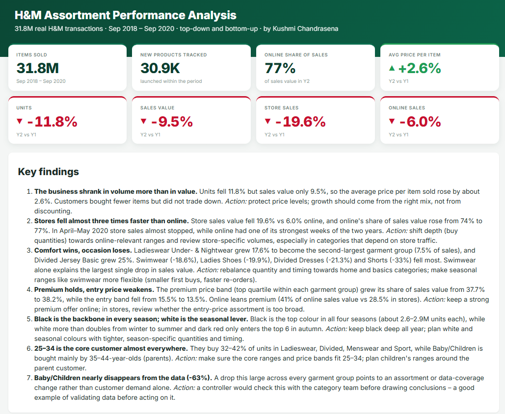
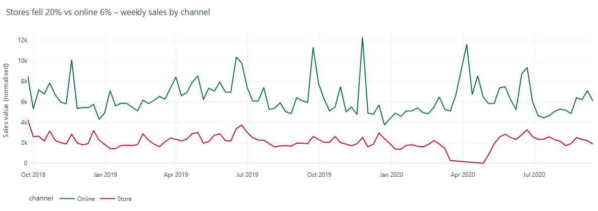
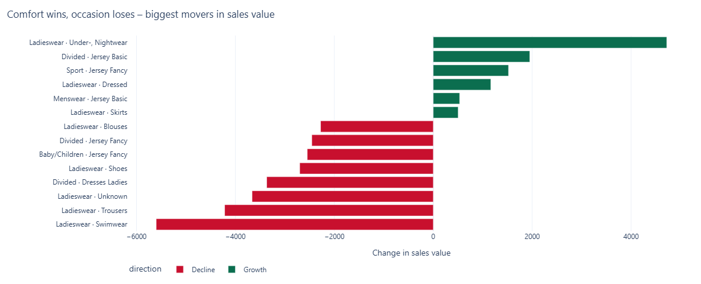
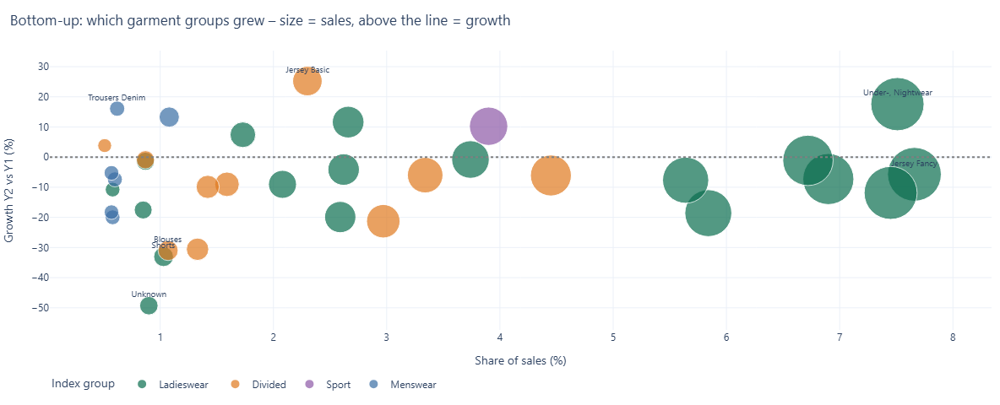
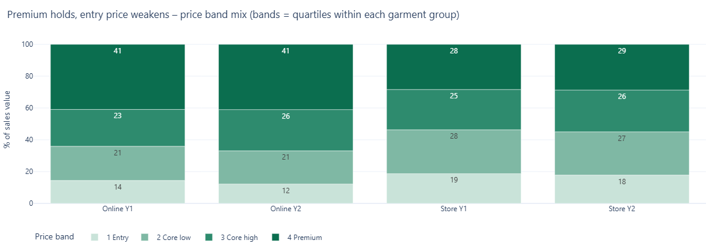
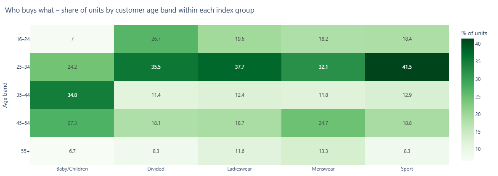

# H&M Assortment Performance Analysis

How did H&M's assortment perform across product groups, price bands, channels and seasons – and where were the growth opportunities and risks?

This project analyses **31 million real H&M transactions** (Sep 2018 – Sep 2020) from the public *H&M Personalized Fashion Recommendations* dataset, the way an assortment controller would: top-down (total business) and bottom-up (each garment group and product).

**Tools:** SQL (DuckDB), Python, Plotly · **Author:** Kushmi Chandrasena

## ▶ Live dashboard
**https://raw.githack.com/kushitec15691/hm-assortment-analysis/main/output/index.html**

## Questions answered
1. **Sales mix and trend** – which index and garment groups drive sales, week by week, in stores and online?
2. **Top-down vs bottom-up** – each group's share of total sales and its growth year on year (Sep 2019–Sep 2020 vs Sep 2018–Sep 2019).
3. **Price bands** – where volume and value sit within each garment group (entry, core, premium).
4. **Product lifecycle** – rate of sale in the first 8 weeks after launch: which products were fast or slow movers within their group?
5. **Customer mix** – which age groups buy which departments, in which channel?
6. **Colour and season** – which colours sell in which season, per garment group.

## Key findings
Year 2 (Sep 2019–Sep 2020) vs Year 1 (Sep 2018–Sep 2019). Year 2 includes the Covid-19 spring of 2020, so treat it as a stress test of the assortment.

1. **The business shrank in volume more than in value.** Units fell 11.8% but sales value only 9.5%, so the average price per item sold rose by about 2.6%. Customers bought fewer items but did not trade down. *Action:* protect price levels; growth should come from the right mix, not from discounting.
2. **Stores fell almost three times faster than online.** Store sales value fell 19.6% vs 6.0% online, and online's share of sales value rose from 74% to 77%. In April–May 2020 store sales almost stopped, while online had one of its strongest weeks of the two years. *Action:* shift depth (buy quantities) towards online-relevant ranges and review store-specific volumes, especially in categories that depend on store traffic.
3. **Comfort wins, occasion loses.** Ladieswear Under- & Nightwear grew 17.6% to become the second-largest garment group (7.5% of sales), and Divided Jersey Basic grew 25%. Swimwear (-18.6%), Ladies Shoes (-19.9%), Divided Dresses (-21.3%) and Shorts (-33%) fell most. Swimwear alone explains the largest single drop in sales value. *Action:* rebalance quantity and timing towards home and basics categories; make seasonal ranges like swimwear more flexible (smaller first buys, faster re-orders).
4. **Premium holds, entry price weakens.** The premium price band (top quartile within each garment group) grew its share of sales value from 37.7% to 38.2%, while the entry band fell from 15.5% to 13.5%. Online leans premium (41% of online sales value vs 28.5% in stores). *Action:* keep a strong premium offer online; in stores, review whether the entry-price assortment is too broad.
5. **Black is the backbone in every season; white is the seasonal lever.** Black is the top colour in all four seasons (about 2.6–2.9M units each), while white more than doubles from winter to summer and dark red only enters the top 6 in autumn. *Action:* keep black deep all year; plan white and seasonal colours with tighter, season-specific quantities and timing.
6. **25–34 is the core customer almost everywhere.** They buy 32–42% of units in Ladieswear, Divided, Menswear and Sport, while Baby/Children is bought mainly by 35–44-year-olds (parents). *Action:* make sure the core ranges and price bands fit 25–34; plan children's ranges around the parent customer.
7. **Baby/Children nearly disappears from the data (-63%).** A drop this large across every garment group points to an assortment or data-coverage change rather than customer demand alone. *Action:* a controller would check this with the category team before drawing conclusions – a good example of validating data before acting on it.

*Note:* values are normalised in the source data, so findings use relative change and shares, not SEK.

## Charts

## Method and data notes
- `sql/build_tables.sql` builds one enriched fact table (transactions + product attributes) and six summary tables; `build_tables.py` runs it with DuckDB, which handles the 31M-row file on a normal laptop.
- `make_dashboard.py` builds the interactive dashboard (KPIs, findings and eight charts) as a single HTML page (`output/index.html`).
- **Prices are normalised in the source data** (not SEK), so values show relative sales value, not actual revenue. Units and shares are exact.
- `sales_channel_id = 2` is treated as online and `1` as store, as commonly interpreted for this dataset.
- The dataset has no stock or purchase data, so sell-through and margin cannot be calculated; rate of sale after launch is used as the closest proxy.
- Year 2 includes the Covid-19 period (spring 2020), which affects store vs online comparisons.

## How to reproduce
1. Download `articles.csv`, `customers.csv` and `transactions_train.csv` from the Kaggle competition *H&M Personalized Fashion Recommendations* (free account; accept the competition rules).
2. `pip install duckdb plotly pandas`
3. `python build_tables.py --data <folder with the CSV files> --out output`
4. `python make_dashboard.py --out output`
5. Open `output/dashboard.html` in a browser.

The raw data is not included in this repository, in line with the Kaggle competition rules.
